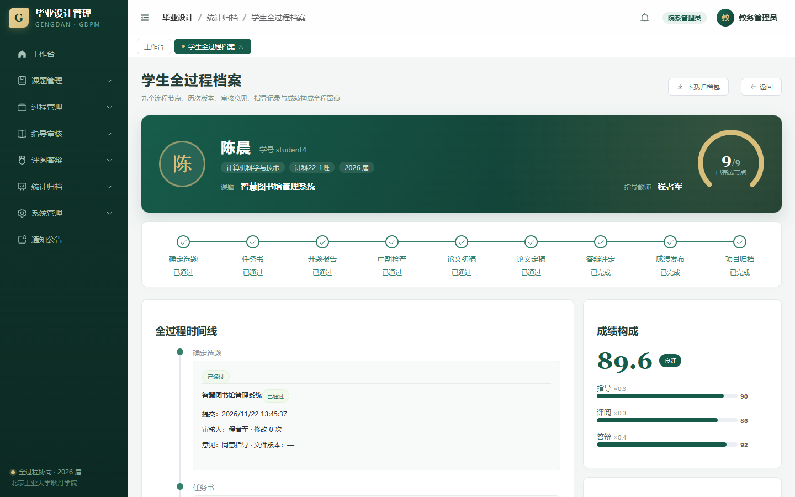
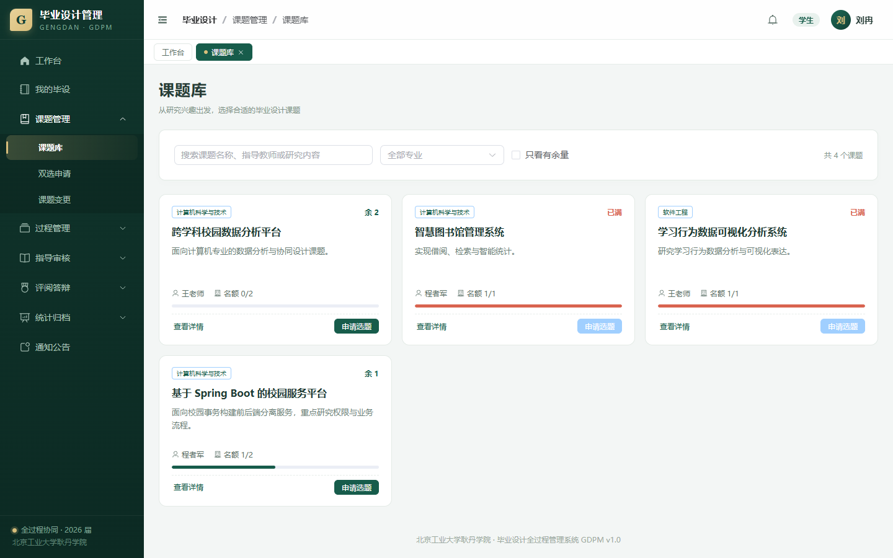
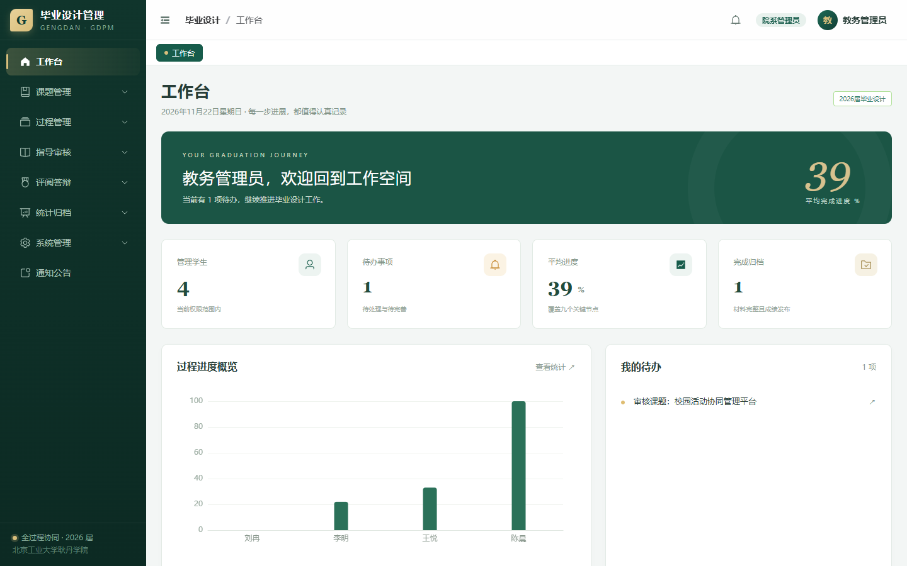
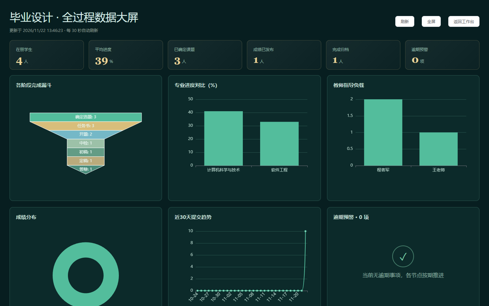

# 毕业设计全过程管理系统

面向学生、指导教师和院系管理员，覆盖选题、课题变更、过程材料、查重、论文评阅、答辩、成绩和归档。

技术栈：Spring Boot 2.7 · MyBatis-Plus · Apache Shiro（RBAC）· Vue 3 · Element Plus · ECharts · MySQL 8 / H2。

| 学生全过程档案 | 课题库（学生） |
| --- | --- |
|  |  |
| **工作台** | **数据大屏** |
|  |  |

更多截图见 [docs/screenshots](docs/screenshots/README.md)。

## 运行与构建

需要 JDK 11+、Node.js 18+、Maven 3.6.3+（或随仓库提供的 Maven Wrapper）。默认使用持久化 H2；可切换到 MySQL 8。
本机路径和镜像设置在忽略入库的 `scripts/local.env.ps1`。数据库凭据只读取进程环境
`GDPM_DB_USERNAME` / `GDPM_DB_PASSWORD`，不得放入本机配置文件、源码或报告。
Maven 使用阿里云，npm 使用 npmmirror，不依赖 7890 代理。构建缓存写入项目 `run/`。

```powershell
.\start.bat -NoBrowser
.\stop.bat
```

默认入口 <http://127.0.0.1:5173>，后端 <http://127.0.0.1:8080/api/health>。
脚本执行后端 package（含集成测试）、前端 build，再以隐藏窗口启动服务。
停止脚本校验 PID、启动时间和程序路径；需要由启动服务的同一用户执行。

本轮已有旧进程占用默认端口且当前用户无权停止，已保留该运行记录。
本轮新版审阅环境使用独立数据与端口：**<http://127.0.0.1:15173>**，后端端口 **18080**。

```powershell
powershell -NoProfile -ExecutionPolicy Bypass -File scripts/start-review.ps1
powershell -NoProfile -ExecutionPolicy Bypass -File scripts/stop-review.ps1
```

此环境的服务、数据库、附件和运行记录位于 `run/preview-v3/`。
原服务由其启动用户停止后，`start.bat` 可在 8080/5173 启动新版；正式 H2 数据和附件保留。

手工构建：

```powershell
cd backend
.\mvnw.cmd -s ../scripts/maven-settings.xml -Dmaven.repo.local=../run/m2repo package
java -Dfile.encoding=UTF-8 -jar target/gdpm-system-v3.jar
cd ../frontend
npm.cmd ci
npm.cmd run build
npm.cmd run dev
```

后端产物为 `backend/target/gdpm-system-v3.jar`，前端产物为 `frontend/dist/`。
H2 正式数据在 `backend/data/`，附件在 `backend/uploads/`，备份时需一起保存。
一键脚本支持 `GDPM_BACKEND_PORT` / `GDPM_FRONTEND_PORT`。

## 演示账号

全部初始密码为 **123456**，密码以 BCrypt 哈希保存。

| 账号 | 角色 | 演示状态 |
| --- | --- | --- |
| admin | 院系管理员 | 课题审核、评阅分配、答辩安排、系统管理 |
| teacher1 | 程者军 | 指导 student2、student4 |
| teacher2 | 王老师 | 指导 student3，评阅 student4 |
| student1 | 刘冉 | 未确定课题，可演示完整闭环 |
| student2 | 李明 | 开题退回；含一次课题变更退回历史 |
| student3 | 王悦 | 中期材料待审核 |
| student4 | 陈晨 | 五阶段材料通过，查重12.5%，评阅86分，成绩89.60，已归档 |

新增跨教师、同专业的演示课题。空库导入完整演示数据，已有库通过幂等迁移补表、补列，保留现有业务。
令牌只存 SHA-256 摘要，12小时过期；退出、停用和换密后失效。

## 二级菜单

| 一级菜单 | 独立页面 |
| --- | --- |
| 工作台 | 待办、范围内进度、截止节点、通知 |
| 我的毕设（学生） | 本人全过程档案 |
| 课题管理 | 课题库、课题申报（教师）、课题审核（管理员）、双选申请、课题变更 |
| 过程管理 | 任务书、开题报告、中期检查、论文提交、查重记录 |
| 指导审核 | 指导记录、待我审核（教师）、审核留痕 |
| 评阅答辩 | 评阅分配（管理员）、我的评阅（教师）、答辩分组、答辩安排、成绩管理 |
| 统计归档 | 进度统计、成绩分析、缺失材料、归档管理、数据大屏（管理员） |
| 系统管理 | 用户管理、角色权限、专业班级、届次管理、流程节点、通知公告、操作日志 |
| 顶栏入口 | 消息铃铛、消息中心、个人中心 |

页面保存在 `frontend/src/views/`，同类业务共用组件，不复制页面代码：

| 组件 | 作用 |
| --- | --- |
| `layout/AppLayout.vue` | 主布局：按角色与权限生成的二级菜单、面包屑、站内消息、可右键关闭的多页签 |
| `components/material/StageMaterialBoard.vue` | 任务书、开题、中期、论文、待我审核共用的材料看板（学生版本时间线 / 教师审核表格） |
| `components/topic/TopicBoard.vue` | 课题库（学生卡片墙）、课题申报、课题审核共用 |
| `components/DataTable.vue` | 列表：关键词检索、状态快捷筛选、分页、骨架屏、空状态 |
| `components/ReviewDialog.vue` | 审核对话框：对象摘要、常用意见、意见必填留痕 |
| `components/FileUploader.vue` | 拖拽上传：类型与大小校验、上传进度 |
| `components/StageTimeline.vue` | 学生全过程档案的九节点时间线 |
| `utils/confirm.js` | 二次确认，取消不报错、接口错误不吞掉 |

路由守卫校验角色与权限码，`v-permission` 控制按钮显示；后端再次校验身份与数据范围。
旧 `/materials`、`/system` 路由兼容跳转到开题报告、用户管理。系统截图见 `docs/screenshots/`。

## 业务规则

- 双选按专业、截止时间和剩余名额校验。学生行主键确保唯一分配，事务与课题行锁防止超额。
- 课题变更依次经过原指导教师、新指导教师、管理员。拒绝任一步均不改变分配；终审原子调整师生关系，
  动态释放原课题名额并占用新课题名额；历史材料和审核意见保留，后续审核责任移交新教师。
  任何跳级、重复终审、在途重复申请或最后一个名额竞争都由后端拦截。
- 任务书由指导教师下达。开题 → 中检 → 初稿 → 定稿依次提交；退回后生成新版本，保留全部旧文件与意见。
- 查重由指导教师或管理员登记平台、重复率和报告文件，绑定具体定稿版本。
  最新查重超过定稿流程节点阈值（默认30%）或尚无报告时，定稿不能通过。
- 管理员为定稿通过的学生手工或批量随机分配评阅教师，回避本人指导教师。
  仅指定教师可填写意见、分数及是否同意答辩；未完成或不同意评阅的学生不能安排答辩。
- 成绩的评阅分直接读取论文评阅结果，客户端不能替换。指导/评阅/答辩权重之和为1，BigDecimal 保留两位小数。
  未发布成绩对学生隐藏；发布后禁止改分。
- 消息自动覆盖课题/双选/材料提交和审批结果、变更审批、评阅、答辩安排、成绩发布。
  每天北京时间08:00通过 `@Scheduled` 为三天内将截止且未完成的节点生成去重提醒。
  私人消息按收件人隔离，支持全部/未读、单条已读和一键已读，顶栏角标同步更新。
- 个人中心可维护姓名、邮箱、电话。换密必须校验旧密码，新密码需8至32位并包含字母和数字，换密后全部会话失效。
- 学生档案以九节点时间线显示状态、提交时间、审核人、意见、修改次数和所有文件版本，附指导记录与成绩构成。
  教师和管理员可从学生列表进入，学生直接进入“我的毕设”。
- 完整材料和已发布成绩才可归档；ZIP包含五阶段最终版附件、成绩单.xlsx、归档清单.txt和批次清单。
  支持单学生下载及管理员按班级批量打包，未完成项目不进入班级包。
- 数据大屏为独立深色页面：阶段漏斗、专业进度、教师负载、成绩分布、近30天提交趋势、滚动逾期预警。
  每30秒自动刷新，可切换浏览器全屏。
- 上传支持 PDF、DOC、DOCX、TXT、ZIP，20MB以内，校验扩展名及文件特征；附件通过鉴权接口下载。

## Excel 模板与导出

用户管理中下载模板并上传 `.xlsx`，使用 EasyExcel 读取。必须保留第一行标题：

| 账号 | 姓名 | 初始密码 | 角色编号 | 专业编号 | 班级编号 | 届次 |
| --- | --- | --- | --- | --- | --- | --- |
| example_student | 示例学生 | Change1234 | 3 | 1 | 1 | 2026 |

导入前删除示例行。角色1=管理员、2=教师、3=学生；专业和班级编号见基础数据，班级必须属于专业，届次必须存在。
账号唯一，初始密码遵循用户创建规则。每批最多2000行、20MB，逐行返回原Excel行号、成功/失败和原因；失败行不影响有效行。
返回结果不含密码。成绩管理/成绩分析、进度统计、缺失材料页均可导出真正的 `.xlsx`。

## Swagger 与接口

Swagger UI：<http://127.0.0.1:8080/swagger-ui/index.html>，OpenAPI：<http://127.0.0.1:8080/v3/api-docs>。
本轮预览对应 <http://127.0.0.1:18080/swagger-ui/index.html>。
全部25个控制器和操作具有中文 `@Tag` / `@Operation`。在 Swagger 中先调用登录接口，再点 Authorize 粘贴 token。
按[官方兼容说明](https://github.com/springdoc/springdoc-openapi)选用适配 Spring Boot 2 的 springdoc 1.8.0。
Excel 使用[EasyExcel](https://github.com/alibaba/easyexcel)。

JSON统一返回 `Result<T>`；错误的业务code与HTTP状态一致。受保护接口使用 `Authorization: Bearer <token>`。
列表支持可选 `?page=1&size=20`，分页前执行服务端数据范围过滤；未传分页参数时保留原数组响应。
文件下载返回二进制，健康探针保持原协议。

| 新增接口 | 用途 |
| --- | --- |
| GET/POST /api/topic-changes；POST /api/topic-changes/{id}/approve | 变更与三级审批 |
| GET /api/thesis-reviews；POST /api/thesis-reviews/assign；POST /api/thesis-reviews/{id}/review | 评阅分配与填写 |
| GET/POST /api/plagiarism-checks | 查重报告 |
| GET /api/messages；POST /api/messages/{id}/read；POST /api/messages/read-all | 个人消息 |
| PUT /api/profile；POST /api/profile/password | 个人资料与换密 |
| GET /api/students/{id}/dossier | 全过程档案 |
| GET /api/archives/download?studentId=7 或 classId=1 | 归档ZIP |
| GET /api/system/users/template；POST /api/system/users/import | 模板与导入 |
| GET /api/exports/scores、statistics、missing | Excel导出 |
| GET /api/statistics/board | 数据大屏 |

原课题、双选、材料、指导、答辩、成绩、统计、系统管理接口保持兼容，具体可执行字段见 `scripts/selftest.py`。

## MySQL 与数据库升级

首次初始化可在 MySQL 8 中执行 `sql/init.sql`，创建 utf8mb4 的 gdpm 库与30张业务表。
该文件与 `backend/src/main/resources/db/schema.sql`、`data.sql` 保持一致，不得向已有业务库重复导入演示数据。
已有库启动时执行幂等增量迁移。新增表为 topic_change、thesis_review、plagiarism_check、sys_message；
个人联系方式和节点查重阈值为新增字段。

凭据由终端的进程环境提供，然后执行：

```powershell
$env:SPRING_PROFILES_ACTIVE='mysql'
# 可选：DB_URL 指向独立业务库，默认本机3306的gdpm
.\start.bat -NoBrowser
```

切回 H2 时停止服务并清除 `SPRING_PROFILES_ACTIVE`，或设为 `dev`。

## 可重复验证

构建会运行26项 Spring Boot 集成测试（含后端规范化回归）。独立自测不覆盖正式数据；MySQL 自测随机创建 `gdpm_r3_...` 库，
读取同一 `sql/init.sql`，结束后仅删除本次创建的测试库，现有 gdpm 不变。
要求 mysql 客户端可用，数据库账号具备创建/删除测试库权限，凭据仍只从上述环境变量读取。

```powershell
python -X utf8 scripts/selftest.py
python -X utf8 scripts/selftest.py --profile mysql
python -X utf8 scripts/verify_source.py
python -X utf8 backend/scripts/verify_normalization.py
$env:GDPM_FRONTEND_URL='http://127.0.0.1:15173'
python -X utf8 scripts/frontend_smoke.py
node scripts/browser_round3.mjs
node scripts/browser_round3.mjs --focus
$env:GDPM_TEST_FRONTEND_URL='http://127.0.0.1:15173'
node scripts/browser_pending_check.mjs
```

浏览器脚本沿用 `run/browser-tools` 的 Playwright 和本机 Chrome。布局验收覆盖1024/1366/1920、五种角色/状态，
截图与 JSON 证据保存在 `run/`；README 截图由 `node scripts/capture_screenshots.mjs` 生成。
`browser_pending_check.mjs` 只用于独立演示环境，会生成一条待确认双选。
全部测试方法与结果见 [测试报告](docs/TEST_REPORT.md)。

## 代码结构

后端保持 entity / mapper / service / service/impl / controller / dto / vo 分层，Shiro 注解鉴权，
`@OperLog` 统一审计，跨表查询放 Mapper XML。前端 API 按业务拆分，组件和主题独立复用。
写接口由 Controller 使用 `@Valid @RequestBody` 绑定请求 DTO，字段名保持原有 JSON 协议。
DTO 使用 `javax.validation` 约束必填、长度、编号、分数及权重范围和精度；创建用户、下达任务书、
维护班级和届次等条件必填项使用校验分组，Service 的直接调用与 Excel 导入执行相同约束。
审核结果只接受 JSON 布尔值，整数字段拒绝浮点截断；字段校验统一返回 HTTP 400 与中文提示。
身份、数据范围、截止时间、前置材料、审批顺序及并发名额仍在 Service 事务中核验。
实体由显式 setter 构造，Service 返回实体、明确 VO 或 `List<Map<String, Object>>` 报表行，
不使用请求 Map、无类型 Object 返回或按列名反射构造；报表下划线字段保持不变。
可选分页接口以 `Result<?>` 表达两种既有响应：不传分页参数返回数组，传入时返回 `PageVO<T>`，
始终先执行数据范围过滤再分页。业务状态集中在 `BusinessStatus`，SQL/XML 中保留数据库状态字面量。
操作日志记录方法、路径、对象编号和来源 IP；评阅分直接引用已完成且同意答辩的评阅记录。

请求 DTO 一览（另有 `LoginRequest`）：

| 业务 | 请求 DTO |
| --- | --- |
| 课题与审批 | `TopicSaveRequest`、`ReviewRequest`、`TopicChangeRequest` |
| 材料与指导 | `MaterialSubmitRequest`、`GuidanceSaveRequest`、`PlagiarismRegisterRequest` |
| 评阅、答辩与成绩 | `ThesisReviewAssignRequest`、`ThesisReviewRequest`、`DefenseGroupRequest`、`DefenseArrangeRequest`、`ScoreSaveRequest` |
| 归档与流程 | `ArchiveRequest`、`WorkflowUpdateRequest` |
| 用户与个人资料 | `UserSaveRequest`、`ProfileUpdateRequest`、`PasswordChangeRequest` |
| 系统维护 | `BaseDataSaveRequest`、`RoleSaveRequest`、`PermissionSaveRequest`、`NoticeSaveRequest` |

`EntityViews` 负责实体到报表字段的转换；`Values` 仅服务于查询结果和报表视图。
后端规范检查脚本只读扫描显式导入、全限定类型、DTO、实体构造、返回类型、状态、中文 Javadoc 和行宽，
结果写入 `backend/target/qc-round4/normalization.json`。全链路证据沿用 `run/selftest-h2/` 与
`run/selftest-mysql/`，每套均执行 `pagination-scope/` 分页与越权检查；测试服务仅使用18081和18082独立端口。

源码单行不超过120字符，Java使用中文Javadoc。运行日志、测试数据库、缓存和临时请求都在忽略入库的 `run/`。
数据库账号、密码和令牌不写入交付报告或业务日志；curl临时请求/响应在自测结束时清理。
